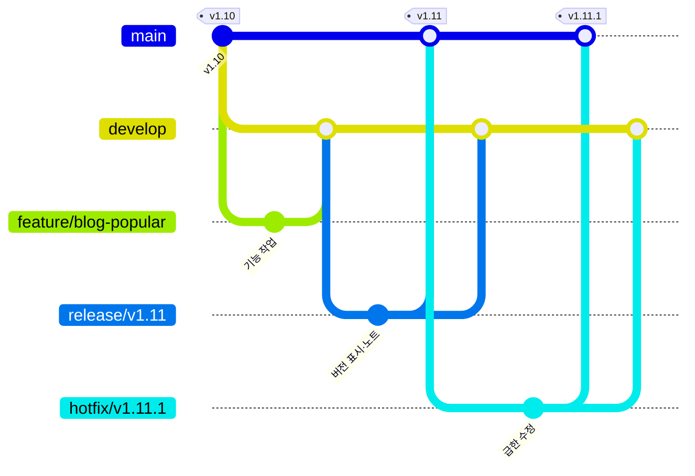

# 브랜치 전략 (Git Flow)

이 저장소는 Git Flow로 브랜치를 나눕니다(D-123). 운영 사이트(https://mainttblog.java21.net)에는 `main`만 나갑니다.

| 브랜치 | 만드는 곳 | 합치는 곳 | 하는 일 |
|---|---|---|---|
| `main` | — | — | 운영. 합치면 GitHub Actions가 바로 배포한다. 직접 커밋하지 않는다 |
| `develop` | `main` | — | 다음 버전에 들어갈 작업을 모은다 |
| `feature/<이름>` | `develop` | `develop` | 기능 하나. 예: `feature/blog-background` |
| `release/vX.YY` | `develop` | `main`, `develop` | 배포 준비. 버전 표시(`SITE_VERSION`)·README 업데이트 줄·릴리스 노트만 고친다 |
| `hotfix/vX.YY.Z` | `main` | `main`, `develop` | 운영에서 난 급한 오류 수정 |

## 순서

1. 기능: `develop`에서 `feature/<이름>`을 만들어 작업하고, 끝나면 `develop`에 합친다(`--no-ff`).
2. 배포 준비: `develop`에서 `release/vX.YY`를 만들고 버전 표시와 README 업데이트 줄을 고친다.
3. 배포: `release/vX.YY`를 `main`에 합친다. `main`에 push되면 배포되고, 태그 워크플로(tag.yml)가 `layout.js`의 버전으로 `vX.YY` 태그를 자동으로 단다(D-124).
4. 릴리스 노트: 배포를 확인한 뒤 `release/vX.YY`에 `release-notes/<날짜-이름>/notice.md`를 더해 `main`에 한 번 더 합친다. 노트만 바뀐 push는 배포하지 않고 사이트 공지로만 올린다(D-108).
5. 마무리: `release/vX.YY`를 `develop`에 합치고 release 브랜치를 지운다.
6. 급한 수정: `main`에서 `hotfix/vX.YY.Z`를 만들어 고치고 버전 표시를 `vX.YY.Z`로 올린 뒤 `main`과 `develop`에 모두 합친다. 태그는 자동으로 달린다.

## 커밋 메시지

관련 요구사항 ID와 결정 번호를 적습니다. 예: `블로그 배경 이미지 (BLG-05, D-121)`.
배포가 필요 없는 문서만의 커밋은 끝에 `[skip ci]`를 붙입니다.
