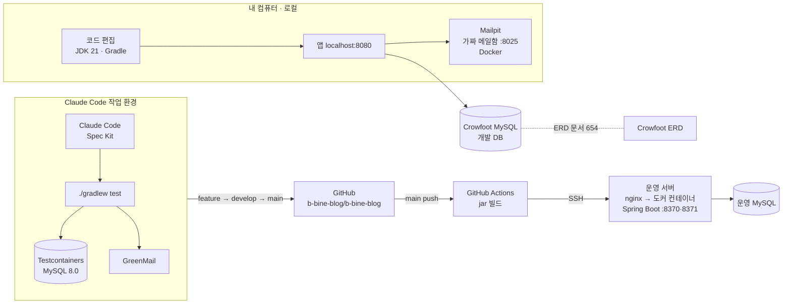

# 개발환경

b-bine blog를 만들고, 시험하고, 운영 서버에 올리는 환경을 정리합니다.
처음 실행하는 방법은 [README "내 컴퓨터에서 바로 써 보기"](README.md#내-컴퓨터에서-바로-써-보기)에 있습니다.

## 한눈에 보기

## 환경별 구분

| 환경 | 어디서 | DB | 메일 | 사람 확인(Turnstile) | 주소 |
|---|---|---|---|---|---|
| 로컬 | 팀원 컴퓨터(`local/start.sh`) | Crowfoot이 내어 준 MySQL(`cf_u33_d1`) | Mailpit 가짜 메일함(Docker) | Cloudflare 테스트 키(항상 통과) | http://localhost:8080 |
| 테스트 | Claude Code 작업 환경(`./gradlew test`) | Testcontainers가 띄우고 버리는 MySQL 8.0 | GreenMail(테스트 안 SMTP) | 테스트 키 | 없음 |
| 운영 | 학원 공용 서버(GitHub Actions가 배포) | 운영 MySQL | Gmail SMTP | 실제 키 | https://mainttblog.java21.net |

- 테스트는 데이터를 지우고 다시 넣기 때문에 Crowfoot DB에 연결하지 않고 매번 새 MySQL을 씁니다. 테이블은 [db/schema.sql](db/schema.sql)로 만듭니다.
- 로컬은 http라 `AUTH_COOKIE_SECURE=false`로 쿠키의 Secure를 끕니다. 운영은 켭니다.
- Docker는 로컬의 가짜 메일함, 테스트용 MySQL, 운영 컨테이너(D-127)에 씁니다. 운영 이미지에 Java 21이 들어 있어 서버의 Java 버전과 상관없이 돕니다.

## 도구와 버전

| 구분 | 사용 | 버전 |
|---|---|---|
| 언어·런타임 | Java (Temurin) | 21 |
| 빌드 | Gradle Wrapper(`./gradlew`) | 8.14.3 |
| 프레임워크 | Spring Boot | 3.5.16 |
| DB | MySQL | 8.0 |
| 테스트 | JUnit 5, Testcontainers, GreenMail | GreenMail 2.1.14 |
| 가짜 메일함 | Mailpit | 1.21.8 |
| ERD·DB 관리 | [Crowfoot](https://crowfoot.java21.net) | 문서 "메인블로그"(654) |
| AI 개발 | Claude Code + [Spec Kit](https://github.com/github/spec-kit) | 문서 저장소의 `.claude/skills/speckit-*` |
| 저장소·CI/CD | GitHub, GitHub Actions | `.github/workflows/` |
| 운영 실행 | Docker(`Dockerfile`, `eclipse-temurin:21-jre`) | 서버 Docker 29.7.2 |
| 운영 웹 서버 | nginx(공용 인프라가 관리) | 설정 사본 `deploy/nginx/` |

Gradle Wrapper가 정해진 Gradle을 내려받으므로 Gradle은 따로 설치하지 않습니다. 필요한 것은 JDK 21과 (로컬 메일함용) Docker뿐입니다.

## 설정값과 비밀 값

- 모든 숫자 규칙(만료 시간, 제한 횟수, 용량)은 `src/main/resources/application.yml`에 `${환경변수:기본값}` 형태로 둡니다(D-68). 코드에 숫자를 박지 않습니다.
- 로컬의 비밀 값은 저장소 루트의 `.env`에 둡니다. `local/start.sh`가 처음 실행할 때 무작위 키로 만들어 주고, 이 파일은 저장소에 올리지 않습니다. 어떤 값이 필요한지는 [.env.example](../../.env.example)에 있습니다.
- 운영의 비밀 값(DB, JWT·HMAC 키, Gmail 앱 비밀번호, Turnstile, 소셜 로그인 키, SSH 접속 정보)은 GitHub Repository secrets에 둡니다. 배포할 때 서버에 나만 읽을 수 있는 `secrets.env`로 만들어 컨테이너에 붙입니다. 같이 쓰는 서버에서 `docker inspect`로 보이지 않게 `-e`로는 넘기지 않습니다(D-127).
- 소셜 로그인 키(`OAUTH_*`)는 비워 두면 그 버튼이 나오지 않을 뿐 앱은 그대로 뜹니다.

## DB 구조 바꾸기

1. Crowfoot의 "메인블로그" ERD 문서를 먼저 고칩니다.
2. 변경 계획(plan_migration)을 확인하고 승인한 뒤 DB에 반영합니다.
3. `db/schema.sql`을 Crowfoot에서 다시 내보냅니다. 테스트가 이 파일로 DB를 만들기 때문에, 바뀐 구조로 테스트가 돕니다.

## 개발 흐름

1. **명세 → 계획 → 작업 → 구현**: 기능마다 Spec Kit으로 [문서 저장소](https://github.com/b-bine-blog/b-bine-blog-docs)의 `specs/<번호>-<기능>/`에 명세(spec.md), 계획(plan.md), 데이터 모델, API 계약(이 저장소의 `api-contracts/`), 작업 목록(tasks.md)을 만든 뒤 구현합니다.
2. **결정 기록**: 정하거나 바꾼 것은 이유와 함께 [결정 기록](https://github.com/b-bine-blog/b-bine-blog-docs/blob/main/docs/03-decisions/README.md)(D-번호)에 남깁니다.
3. **브랜치**: Git Flow(D-123). `feature/*`에서 작업해 `develop`에 합치고, 배포할 때 `main`에 합칩니다. 자세한 순서는 [CONTRIBUTING.md](CONTRIBUTING.md).
4. **테스트**: `develop`·`feature/*`·`release/*`·`hotfix/*`에 push하거나 PR을 만들면 GitHub Actions(`ci.yml`)가 `./gradlew test`(통합 테스트 전체, Testcontainers)를 자동으로 돌립니다(D-128). 초록색인 것만 `main`에 합칩니다.
5. **배포**: `main`에 push되면 GitHub Actions가
   - `deploy.yml`: jar를 만들어 `Dockerfile`과 함께 SSH로 서버에 올리고, `deploy/deploy.sh`가 서버에서 이미지를 만들어 컨테이너로 실행(D-127). 늘 떠 있는 앱 2개(8371, 8370)를 하나씩 차례로 새 버전으로 바꾼다(롤링, D-129)
   - `tag.yml`: 사이트 버전(`layout.js`의 `SITE_VERSION`)으로 태그를 단다(D-124)
   - `release-note.yml`: `release-notes/`의 노트를 사이트 공지로 올림(D-108)

## 운영 서버

- 서버 폴더 `~/blogproject`: 업로드 이미지(`uploads/`, 재배포해도 남음), 비밀 값 파일(`secrets.env`, 나만 읽기). 실행 로그는 `docker logs mainttblog-<포트>`.
- nginx가 https를 받아 앱(`127.0.0.1:8370`, nginx 설정을 바꾼 뒤에는 8370·8371 둘 다)으로 넘기고, 앱이 꺼져 있으면 점검 중 화면을 보여 줍니다.
- 서버 접속은 `ssh -p 8822 <계정>@<주소>`입니다. 계정과 주소는 학원 공통 인프라 문서에 있고, 저장소에는 적지 않습니다.
