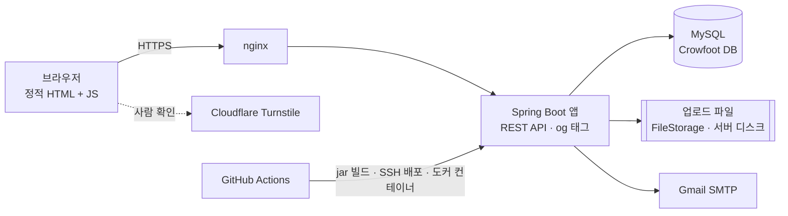
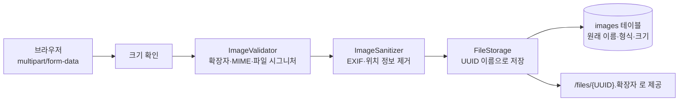

# b-bine blog

여러 사람이 함께 쓰는 블로그 플랫폼입니다. 👉 **https://mainttblog.java21.net**

회원은 메인 사이트에서 가입·로그인하고, 자기 블로그를 만들거나 다른 블로그에 참여해 함께 운영합니다.
블로그장·부블로그장·멤버는 계정 종류가 아니라 블로그마다 정해지는 역할입니다.

## 목차

- [주요 기능](#주요-기능)
- [기술 스택](#기술-스택)
- [구조](#구조)
- [데이터베이스(ERD)](#데이터베이스erd)
- [파일 업로드](#파일-업로드)
- [폴더 구조](#폴더-구조)
- [개발 방식](#개발-방식)
- [브랜치 전략](#브랜치-전략)
- [팀](#팀)
- [업데이트](#업데이트)
- [내 컴퓨터에서 바로 써 보기](#내-컴퓨터에서-바로-써-보기)
- [실행](#실행)
- [테스트](#테스트)
- [문서](#문서)

## 주요 기능

| 영역 | 기능 |
|---|---|
| 회원 | 이메일 인증(6자리 번호) 회원가입, 로그인·로그인 유지(14일), 이메일·비밀번호 찾기, 내 정보·프로필 사진, 탈퇴 |
| 블로그 | 블로그 만들기(공개 3·비공개 5개까지), 참여 신청·승인, 부블로그장 권한(정보·멤버·글 관리), 블로그장 위임, 제재·블랙리스트, 폐쇄, 대표·배경 이미지 |
| 게시판 | 글 쓰기(마크다운 에디터), 카테고리·태그, 이미지 첨부, 댓글·대댓글·좋아요, 링크 공유 미리보기(og), 통합 검색, 메인 피드(최신·인기·구독·팔로우) |
| 소셜·알림 | 팔로우·차단·신고, 블로그 구독, 알림(30초마다 확인)과 알림 설정 |
| 관리자 | 회원·블로그·신고·글 관리, 활동 기록, 통계, 공지사항, 시스템 문의 |
| 화면 | 다크 모드, 시간대에 따라 바뀌는 사이트 색, 로그인·회원가입 창, 휴대폰 화면 |

## 기술 스택

| 구분 | 사용 |
|---|---|
| 백엔드 | Java 21, Spring Boot 3.5, Spring Security, Spring Data JPA·JdbcTemplate |
| DB | MySQL 8 (ERD와 DB는 [Crowfoot](https://crowfoot.java21.net)으로 관리) |
| 인증 | JWT + HttpOnly 쿠키, Refresh Token DB 저장, bcrypt, Cloudflare Turnstile |
| 화면 | 정적 HTML + JavaScript(API 호출), Toast UI Editor, 글 상세만 서버가 og 태그를 채움 |
| 보안 | CSRF 토큰, CSP·보안 헤더, 서버에서 마크다운→HTML 변환 후 jsoup으로 걸러냄, 개인정보는 서버에서 가려서 응답 |
| 메일 | Gmail SMTP (로컬은 Mailpit 가짜 메일함) |
| 파일 | `FileStorage` 인터페이스로 서버 디스크에 저장(나중에 S3로 바꿀 수 있게 분리) |
| 테스트 | JUnit 5, Testcontainers(MySQL), GreenMail |
| 배포 | GitHub Actions → SSH로 서버에 jar 전송 → 서버에서 도커 이미지로 실행(D-127), 앱 2개(8370·8371)를 하나씩 바꾸는 롤링 배포(D-129), nginx |

## 구조



- 화면은 `src/main/resources/static`의 정적 파일이고, 모든 데이터는 `/api/**`로 주고받습니다. 공통 `api.js`가 CSRF 헤더(`X-XSRF-TOKEN`)를 붙입니다.
- 서버는 기능별 패키지(`member`, `auth`, `blog`, `board`, `social`, `notification`, `admin`, `inquiry`)로 나누고, 각 패키지 안에서 `api`(컨트롤러) → `application`(서비스) → `domain`(엔티티·저장소)으로 나눕니다.
- 블로그 안에서 할 수 있는 일은 계정 종류가 아니라 그 블로그에서의 역할로 매번 확인합니다(`BlogPermissionService`).

## 데이터베이스(ERD)

- ERD 원본은 Crowfoot 문서 "메인블로그"(654)이고, 실제 DB도 그 문서에 연결돼 있습니다.
- 테이블 정의(DDL): [db/schema.sql](db/schema.sql). 테스트도 이 파일로 DB를 만듭니다.
- DB 구조를 바꿀 때는 Crowfoot 문서를 먼저 고치고, 변경 계획을 확인한 뒤 DB에 반영합니다.

## 파일 업로드

이미지 파일만 받습니다(요구사항 6.3, BRD-05, SEC-08). 숫자는 모두 `application.yml` 설정값입니다(D-68).

| 어디에 | API | 한도 |
|---|---|---|
| 글 이미지 | `POST /api/blogs/{blogId}/images` (공지는 `POST /api/notices/images`) | 장당 3MB, 글 하나에 10장, 한 번에 10MB |
| 프로필 사진 | `PUT·DELETE /api/members/me/profile-image` | 3MB, 1장 |
| 블로그 대표 이미지 | `PUT·DELETE /api/blogs/{blogId}/cover-image` | 3MB, 1장 |
| 블로그 배경 이미지 | `PUT·DELETE /api/blogs/{blogId}/background-image` | 3MB, 1장 (D-121) |



- **형식:** jpg, jpeg, png, gif, webp만 받습니다. svg는 파일 안에 스크립트를 넣을 수 있어 받지 않고, 문서·동영상·압축 파일도 받지 않습니다.
- **검증:** 확장자, MIME 타입, 파일 앞부분 바이트(시그니처)가 모두 같은 형식이어야 통과합니다. 확장자만 바꾼 실행 파일을 막기 위해서입니다. 가로×세로 픽셀 수도 제한해 압축 폭탄을 막습니다.
- **개인정보:** 올릴 때 EXIF(GPS 위치 등)를 지웁니다.
- **저장:** 서버에는 UUID 이름으로 저장하고, 원래 파일 이름은 DB에만 둡니다. 이름 충돌과 경로 조작 공격을 막습니다.
- **정리:** 글에 쓰이지 않은 이미지는 하루 뒤 매일 04:00 정리 작업에서 지움 표시를 하고, 지움 표시한 이미지와 바꾸거나 지운 이미지는 30일 뒤 파일까지 지웁니다(D-100).
- **저장소 교체:** 저장은 `FileStorage` 인터페이스 뒤에 있어, 지금의 서버 디스크(`LocalDiskFileStorage`)를 서버 이중화 때 S3 같은 저장소로 바꿀 수 있습니다(D-75, SCL-02).

## 폴더 구조

```
src/main/java/com/mainblog/   기능별 패키지(api → application → domain)
src/main/resources/static/    화면(HTML·CSS·JS)
src/main/resources/application.yml   설정값(제한값·만료 시간 등, 환경변수로 바꿈)
src/test/                     통합 테스트(Testcontainers)
db/schema.sql                 테이블 정의(DDL). 테스트가 이 파일로 DB를 만듦
api-contracts/                API 계약(OpenAPI). 테스트가 실제 응답과 맞는지 확인
release-notes/                버전별 업데이트 노트(사이트 공지로도 올라감)
deploy/                       서버 실행 스크립트, nginx 설정
local/                        내 컴퓨터에서 실행(start.sh, 예시 데이터)
.github/workflows/            자동 테스트·배포·릴리스 노트 자동화
```

## 개발 방식

- 요구사항분석서 → 기능별 명세 → 계획 → 작업 목록 → 구현 순서로 만듭니다([Spec Kit](https://github.com/github/spec-kit)). 명세와 요구사항 문서는 [문서 저장소](https://github.com/b-bine-blog/b-bine-blog-docs)에 따로 둡니다(D-130).
- 정하거나 바꾼 것은 이유와 함께 [결정 기록](https://github.com/b-bine-blog/b-bine-blog-docs/blob/main/docs/03-decisions/README.md)(D-번호)에 남깁니다.
- 커밋 메시지와 코드 주석에 관련 요구사항 ID(USR·BLG·SOC·BRD·ADM·SEC·SCL)와 결정 번호를 적습니다.

## 브랜치 전략

Git Flow를 씁니다. 자세한 순서는 [CONTRIBUTING.md](CONTRIBUTING.md)에 있습니다.

| 브랜치 | 하는 일 |
|---|---|
| `main` | 운영. 합치면 GitHub Actions가 서버에 배포 |
| `develop` | 다음 버전 작업을 모음 |
| `feature/<이름>` | 기능 하나(`develop`에서 만들어 `develop`에 합침) |
| `release/vX.YY` | 배포 준비(버전 표시·릴리스 노트), `main`과 `develop`에 합침 |
| `hotfix/vX.YY.Z` | 운영 급한 수정(`main`에서 만들어 `main`과 `develop`에 합침) |

## 팀

박민수 · 김재휘 · 정원일 · 김채림 (역할을 나누지 않고 함께 개발)

## 업데이트

새 버전이 나가면 맨 위에 더합니다. 사이트의 공지사항에도 같은 내용이 "업데이트"로 올라갑니다.

| 버전 | 날짜 | 바뀐 점 |
|---|---|---|
| [v1.18](release-notes/2026-10-14-scrap-icon/notice.md) | 2026-10-14 | 스크랩 책갈피 버튼·목록 표시, 작성글·작성댓글·스크랩 창, 글 개수 선택 정리 |
| [v1.17](release-notes/2026-10-14-my-activity/notice.md) | 2026-10-14 | 스크랩·작성글·작성댓글, 메인 피드 태그 탭, 글 "수정됨" 표시, 개인정보 처리방침, 사이트 아이콘 |
| [v1.16](release-notes/2026-10-14-post-category/notice.md) | 2026-10-14 | 글 목록 제목 위에 카테고리와 그림 표시, "미분류"를 "잡담"으로 변경 |
| [v1.15](release-notes/2026-10-14-rolling/notice.md) | 2026-10-14 | 배포 중이나 앱 하나가 멈춰도 사이트가 끊기지 않음(롤링 배포), 문서를 별도 저장소로 분리, README 정리 |
| [v1.14](release-notes/2026-10-14-profile-window/notice.md) | 2026-10-14 | 닉네임을 누르면 프로필이 창으로 뜸, 글 목록의 블로그 이름으로 블로그 이동, 댓글 칸을 본문과 같은 너비로 |
| [v1.13](release-notes/2026-10-13-docker/notice.md) | 2026-10-13 | 서버를 도커 컨테이너로 옮김, 무중단 배포 준비, 소셜 가입 이메일 인증 안내 |
| [v1.12](release-notes/2026-10-13-social-restart/notice.md) | 2026-10-13 | 소셜 가입 도중 새로 고치거나 다시 들어오면 처음부터 |
| [v1.11](release-notes/2026-10-13-social-login/notice.md) | 2026-10-13 | 구글·카카오·네이버로 가입·로그인, 같은 이메일 회원은 비밀번호 확인 뒤 연결, 내 정보에서 소셜 연결 관리 |
| [v1.10](release-notes/2026-10-13-blog-page/notice.md) | 2026-10-13 | 블로그 첫 화면 정리(그림 칸·이름 칸), 블로그 배경 이미지, 관리 블로그 삭제 버튼은 + 를 눌렀을 때만 |
| [v1.09](release-notes/2026-10-13-auth-modal/notice.md) | 2026-10-13 | 로그인·회원가입을 지금 화면 위 창으로 띄움(창도 시간대 색) |
| [v1.08](release-notes/2026-10-13-daytime-colors/notice.md) | 2026-10-13 | 사이트 색이 시간대에 따라 바뀜(아침 파랑·점심 초록·저녁 빨강), 위쪽 띠 오른쪽에 내 블로그, 내 블로그 목록·블로그 만들기를 내 정보로 합침 |
| [v1.07](release-notes/2026-10-13-spotlight-covers/notice.md) | 2026-10-13 | 메인 위쪽 띠에 최신 공지·인기 블로그·인기 글을 번갈아 표시, 깨진 블로그 표지는 첫 글자로 대신 표시 |
| [v1.06](release-notes/2026-10-13-blog-cards-fix/notice.md) | 2026-10-13 | 메인 화면 블로그 카드가 안 보이던 문제 수정(목록을 10개 받아 앞 5개만 표시) |
| [v1.05](release-notes/2026-10-13-blog-cards-rules/notice.md) | 2026-10-13 | 메인 화면 블로그 둘러보기를 글 위 표지 카드 5개로, 화면 아래 "운영 규칙"(삭제 시점·제한 안내) 추가 |
| [v1.04](release-notes/2026-10-13-inquiry-dark/notice.md) | 2026-10-13 | "시스템 문의"로 관리자에게 문의(비회원도 가능), 다크 모드 |
| [v1.03](release-notes/2026-10-12-og-preview/notice.md) | 2026-10-12 | 링크 미리보기 그림을 글 화면 모양으로, 업데이트 공지에 "업데이트" 표시 |
| [v1.02](release-notes/2026-10-12-feed-notice/notice.md) | 2026-10-12 | 메인 글 목록 위에 최근 공지 고정, 메뉴 정리 |
| [v1.01](release-notes/2026-10-12-github-link/notice.md) | 2026-10-12 | 화면 아래에 GitHub 링크 |
| [v1.00](release-notes/2026-10-12-b-bine-blog/notice.md) | 2026-10-12 | 새 이름 b-bine blog와 초록 디자인 |

## 내 컴퓨터에서 바로 써 보기

#### 준비물
- JDK 21
- Docker (가짜 메일함에만 씀)
- DB는 따로 띄우지 않고 Crowfoot이 내어 준 MySQL(문서 654에 연결된 `cf_u33_d1`)을 씁니다.

#### 실행
저장소 루트에서 아래 하나만 실행합니다.

```bash
./local/start.sh        # macOS·Linux
local\start.bat         # Windows
```

1. 처음 실행하면 Crowfoot DB 접속 정보(호스트·포트·사용자·비밀번호)를 묻습니다.
2. Crowfoot 화면의 메인블로그 문서 → 데이터베이스 탭에 있는 값을 넣습니다. `.env`에 저장되어 다음부터는 묻지 않습니다.
3. 가짜 메일함과 앱이 차례로 뜹니다.
4. http://localhost:8080 으로 들어갑니다.

#### 예시 계정
아래 계정은 Crowfoot DB에 이미 들어 있습니다(`local/seed.sql`과 같은 내용, 번호 101부터).

| 계정 | 비밀번호 | 들어 있는 것 |
|---|---|---|
| owner@local.test | Passw0rd! | 블로그 `travel-log`의 블로그장. 참여 신청 1건이 기다리는 중 |
| member@local.test | Passw0rd! | `travel-log` 멤버, 블로그 `daily-note`의 블로그장 |
| newbie@local.test | Passw0rd! | `travel-log`에 참여 신청한 회원 |
| admin@local.test | Passw0rd! | 관리자 |

#### 기능별로 써 보기
| 기능 | 어디서 | 해 볼 것 |
|---|---|---|
| 블로그(002) | `/blog/travel-log` | 블로그 홈. 뒤에 `/manage`를 붙이면 운영 화면 |
| 게시판(004) | 블로그 홈 | 글 목록·카테고리·글쓰기 |
| | 글 상세 | 댓글·좋아요·링크 복사 |
| | 메인 | 피드 탭, 통합 검색(`/search`), 태그 글(`/tags/{이름}`), 공지사항(`/notices`, 관리자만 쓰기) |
| 소셜·알림(003) | 닉네임 → `/profile/{번호}` | 팔로우·차단·신고·팔로워 목록 |
| | 상단 종 아이콘 | 알림 사이드바(탭·읽음·삭제, 30초마다 개수 확인) |
| | 내 정보 | 소개 고치기, 알림 설정(`/me/notifications.html`), 차단 목록(`/me/blocks.html`) |
| 관리자(005) | `admin@local.test` → `/admin` | 회원(가린 이메일·전화번호, "전체 보기"), 블로그(숨김·강제 폐쇄·경고·강퇴), 신고함, 글·댓글(숨김·삭제·복구), 활동 기록, 통계 |

- 예시 글·댓글·팔로우·알림·관리자 신고는 `local/seed.sql` 아래쪽에 있습니다.

주의: 게시판 예시 글·댓글은 Crowfoot DB에 아직 넣지 않았습니다. 관리자가 아닌 계정에는 `/admin`이 404입니다.

#### 메일
- 회원가입 인증번호 메일은 실제로 나가지 않고 가짜 메일함 http://localhost:8025 (Mailpit)에 쌓입니다.
- 아무 이메일 주소로 가입해도 그 화면에서 인증번호를 볼 수 있습니다.
- 실제 Gmail로 보내려면 `.env`를 이렇게 바꿉니다. `MAIL_PASSWORD`는 보내는 Gmail 계정의 앱 비밀번호입니다.

```
MAIL_HOST=smtp.gmail.com
MAIL_PORT=587
MAIL_SMTP_AUTH=true
MAIL_STARTTLS=true
MAIL_USERNAME=
MAIL_PASSWORD=
```

#### DB 구조 바꾸기
1. Crowfoot 문서를 먼저 고칩니다.
2. 변경 계획(plan_migration)을 확인·승인해 DB에 반영합니다.
3. `db/schema.sql`을 export_ddl로 다시 만듭니다.

#### 멈추기
- 앱: Ctrl+C
- 가짜 메일함:

```bash
docker compose -f local/docker-compose.yml down
```

## 실행

`local/start.sh` 없이 직접 띄우는 방법입니다.

#### 준비물
- JDK 21
- DB는 Crowfoot DB를 쓰므로 MySQL을 따로 띄우지 않습니다.

#### 1. 환경변수
`.env.example`을 `.env`로 복사해 채웁니다. 실행할 때 자동으로 읽습니다.

```bash
cp .env.example .env
```

| 값 | 넣을 것 |
|---|---|
| `DB_URL` | `jdbc:mysql://{Crowfoot 호스트}:{포트}/cf_u33_d1?characterEncoding=UTF-8` |
| `DB_USERNAME`, `DB_PASSWORD` | Crowfoot 화면 데이터베이스 탭의 값 |
| `APP_BASE_URL` | `http://localhost:8080` (글 미리보기 og 주소) |
| `JWT_SECRET`, `CODE_HASH_SECRET`, `BLACKLIST_HASH_SECRET` | 32바이트 이상 무작위 값(예: `openssl rand -base64 48`) |
| `MAIL_*` | Gmail 앱 비밀번호. 비워 두면 메일만 실패하고 화면 응답은 같음 |
| `TURNSTILE_*` | 로컬은 Cloudflare 테스트 키 `1x00000000000000000000AA` / `1x0000000000000000000000000000000AA` |

#### 2. 실행
```bash
./gradlew bootRun
```

http://localhost:8080 으로 들어갑니다.

- 숫자 규칙(만료 시간, 제한 횟수 등)은 모두 `src/main/resources/application.yml`의 설정값이고 환경변수로 바꿀 수 있습니다(D-68).

주의: 로컬은 http라서 로그인 쿠키(Secure)가 `localhost`에서만 동작합니다. IP 주소로 들어가면 로그인이 안 됩니다.

## 테스트

```bash
./gradlew test
```

- 테스트 때만 쓰고 버리는 MySQL 8.0 컨테이너(Testcontainers)를 띄우고 `db/schema.sql`로 표를 만듭니다.
- 메일은 GreenMail(SMTP 3025)로 받습니다.
- `develop`·`feature/*`·`release/*`·`hotfix/*`에 올리거나 PR을 만들면 GitHub Actions(`ci.yml`)가 같은 테스트를 자동으로 돌립니다(D-128).

주의: 테스트가 데이터를 지우고 다시 넣기 때문에 Crowfoot DB에는 연결하지 않습니다. 내 컴퓨터에서 앱만 쓸 때는 테스트가 필요 없습니다.

## 문서

요구사항·정책·결정 기록·기능별 명세는 문서 저장소 **[b-bine-blog-docs](https://github.com/b-bine-blog/b-bine-blog-docs)** 에 있습니다(D-130). 이 저장소에는 소스 코드와, 코드·테스트가 직접 읽는 파일만 둡니다.

- [개발환경](DEVELOPMENT.md): 로컬·테스트·운영 환경, 도구 버전, 설정값과 비밀 값, 개발 흐름
- [CONTRIBUTING.md](CONTRIBUTING.md): 브랜치 전략(Git Flow)
- [CLAUDE.md](CLAUDE.md): AI 코딩 에이전트 작업 규칙
- [api-contracts/](api-contracts/): API 계약(OpenAPI)
- [db/schema.sql](db/schema.sql): 테이블 정의
- 문서 저장소: [기능별 명세](https://github.com/b-bine-blog/b-bine-blog-docs/blob/main/specs/README.md), [요구사항 문서](https://github.com/b-bine-blog/b-bine-blog-docs/blob/main/docs/README.md), [결정 기록](https://github.com/b-bine-blog/b-bine-blog-docs/blob/main/docs/03-decisions/README.md), [개발 원칙](https://github.com/b-bine-blog/b-bine-blog-docs/blob/main/.specify/memory/constitution.md)
