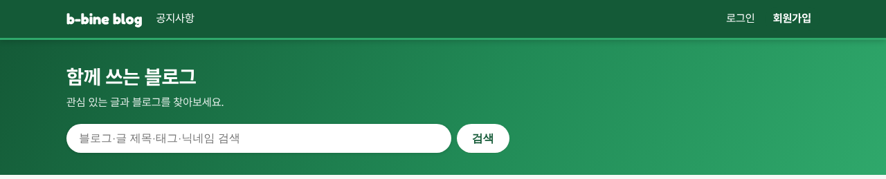
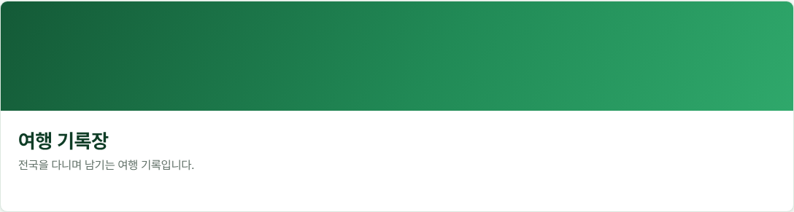

# 업데이트 소식 2026-10-12

이번 업데이트에서 바뀐 점을 알려 드립니다.

## 사이트 이름이 b-bine blog로 바뀌었어요
"블로그"의 블과 combine(합치다)의 바인을 합친 이름으로, 여러 사람이 함께 블로그를 운영한다는 뜻을 담았습니다. 화면 위 로고, 브라우저 탭 제목, 링크 미리보기, 인증 메일 제목에 새 이름이 나옵니다.

## 화면 색과 글꼴
- 색은 초록으로 정리하고, 위 메뉴는 진한 초록, 첫 화면 띠는 초록 그라데이션으로 바꿨습니다.
- 나뭇잎 장식 그림은 빼고 깔끔하게 정리했습니다.
- 글꼴은 무료 글꼴 Pretendard(본문)와 Fredoka(로고)를 씁니다.

## 아래쪽에 GitHub 링크
화면 맨 아래 개인정보 처리방침 옆에 이 사이트의 GitHub 주소를 더했습니다.

