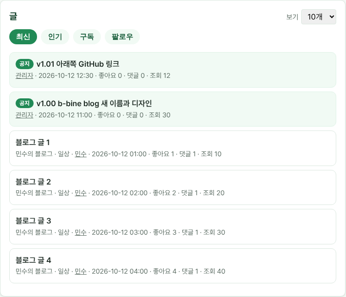
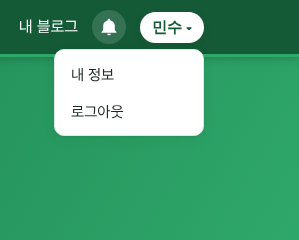

# v1.02 글 목록 공지 고정, 메뉴 정리

메인 화면 "글" 목록의 최신 탭 첫 페이지 맨 위에 최근 공지 3개가 "공지" 표시와 함께 보입니다. 누르면 공지 글로 갑니다.

운영하는 블로그가 있으면 닉네임 메뉴에서 "블로그 만들기"가 빠집니다. 블로그를 더 만들 때는 "내 블로그" 화면의 "블로그 만들기"를 눌러 주세요.

사이트를 만든 GitHub 저장소 주소도 새 주소(github.com/b-bine-blog/b-bine-blog)로 바뀌었습니다.
