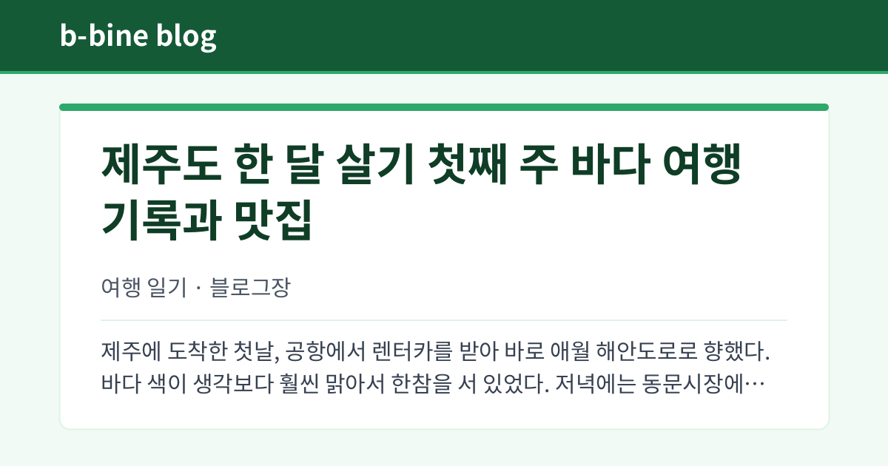

# v1.03 링크 미리보기, 업데이트 표시

메신저나 SNS에 글 주소를 붙이면 나오는 미리보기 그림이 글 화면 모양으로 바뀌었습니다. 글 제목, 블로그 이름, 작성자, 본문 앞부분이 그림에 담깁니다.

비공개 글처럼 볼 수 없는 글의 주소는 그림 없이 "비공개글입니다"만 나옵니다.

공지사항 중 이런 버전 안내 글은 이제 "공지" 대신 "업데이트" 표시가 붙습니다.
