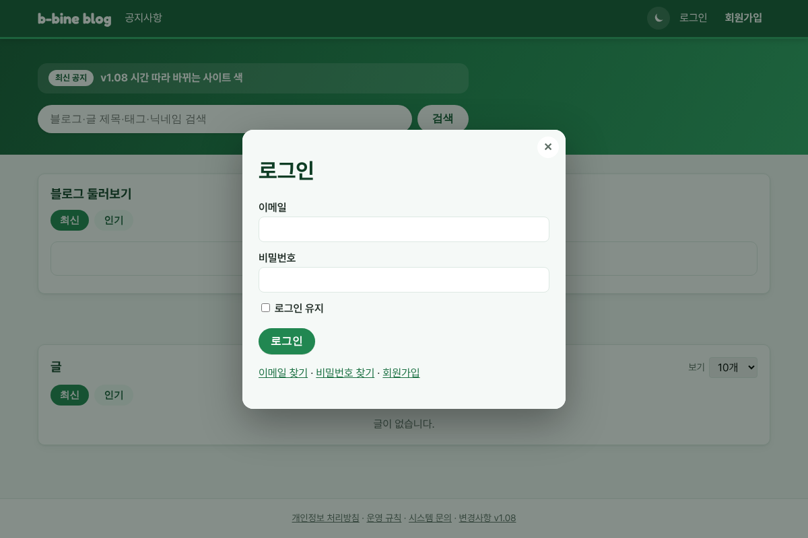
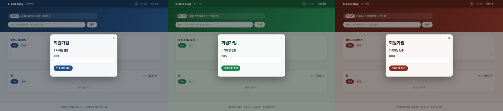

# v1.09 로그인·회원가입이 지금 화면 위 창으로

## 로그인·회원가입이 화면을 옮기지 않아요
위쪽 메뉴의 "로그인"이나 "회원가입"을 누르면, 보던 화면은 그대로 두고 그 위에 창이 떠요. 창 안에서 로그인과 회원가입, 이메일·비밀번호 찾기를 오갈 수 있고, ×나 바깥 클릭, Esc로 닫혀요. 로그인하면 보던 화면이 로그인된 상태로 다시 열려요.

왜 바꿨나요: 다른 화면으로 넘어가면 보던 맥락이 사라져서, 메인 화면 위에 창을 띄워 무엇에 가입하는지 보이게 하려고요.

## 창도 시간대 색을 따라요
창 안의 버튼과 배경, 창 뒤 어두운 부분도 메인 화면과 같은 시간대 색(아침 파랑, 점심 초록, 저녁 빨강)으로 바뀌어요.

왜 바꿨나요: 창도 메인 화면의 색 규칙과 똑같이 해 달라는 요청에 따라 맞췄어요.

