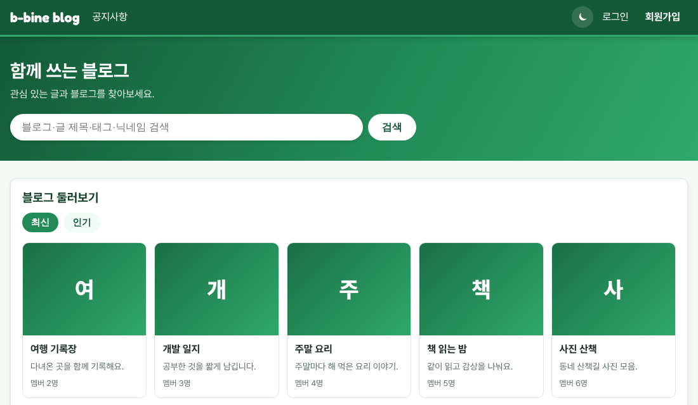

# v1.06 블로그 카드 오류 수정

v1.05를 올린 뒤 메인 화면 "블로그 둘러보기"에 블로그 카드가 안 보이고 "입력값을 다시 확인해 주세요."만 뜨던 문제를 고쳤습니다. 불편을 드려 죄송합니다.

## 무엇이 문제였나요
메인 화면이 블로그를 5개만 달라고 서버에 요청했는데, 서버는 블로그 목록을 한 번에 10개, 20개, 30개 단위로만 보내 주게 되어 있었습니다. 그래서 서버가 요청을 거절했고, 화면에는 그 오류 문구가 나왔습니다.

## 어떻게 고쳤나요
메인 화면이 블로그를 10개 받아서 그중 앞의 5개만 카드로 보여 주도록 바꿨습니다. 블로그 목록 화면의 개수 선택(10·20·30개)은 그대로입니다.

## 다음에는
배포 전에 화면을 확인할 때도 실제 서버와 같은 규칙으로 확인하도록 절차를 고쳤습니다.

