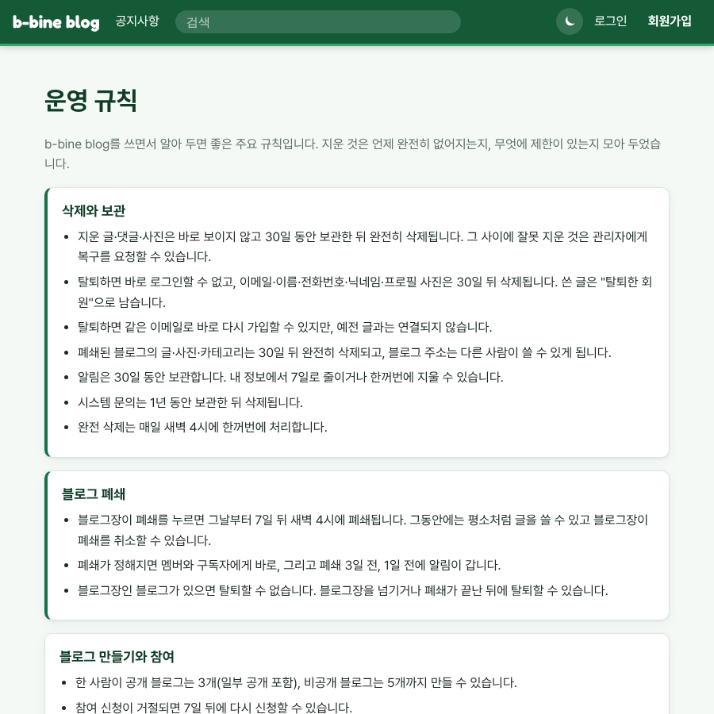

# v1.05 블로그 카드, 운영 규칙

메인 화면이 바뀌었습니다. "블로그 둘러보기"가 글 목록 위로 올라왔고, 블로그마다 표지가 크게 보이는 카드로 5개씩 보여 드립니다. 카드 어디를 눌러도 그 블로그로 갑니다. 휴대폰에서는 옆으로 넘겨 보세요.

화면 맨 아래 "개인정보 처리방침" 옆에 "운영 규칙"도 생겼습니다. 지운 글이나 탈퇴한 계정이 언제 완전히 지워지는지, 블로그 폐쇄는 어떻게 되는지, 글·사진·로그인에 어떤 제한이 있는지 한곳에 모아 두었어요.

화면 맨 아래 "GitHub" 링크는 "변경사항 v1.05"로 이름이 바뀌었습니다. 누르면 지금까지 나온 버전과 바뀐 점을 한눈에 볼 수 있어요.
