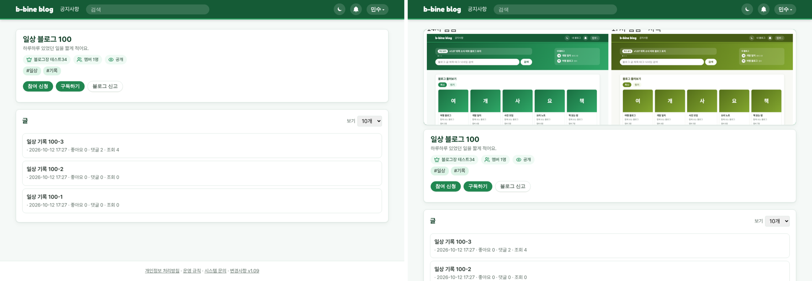
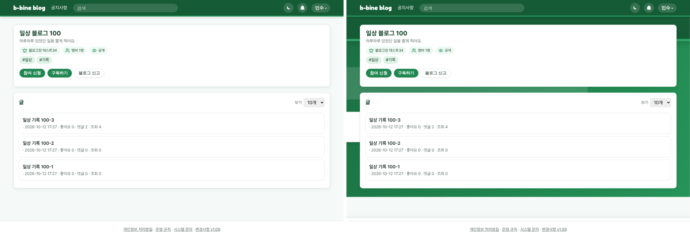
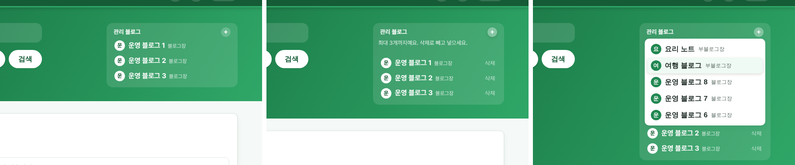
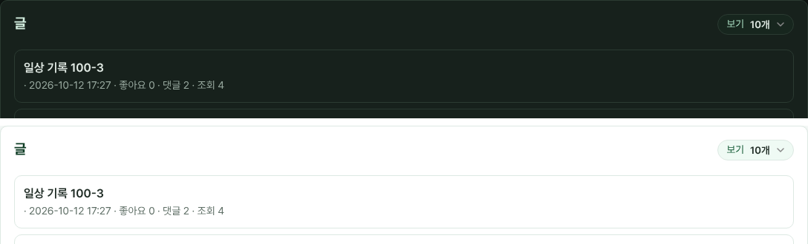

# v1.10 블로그 첫 화면 정리와 배경 이미지

## 블로그 첫 화면이 정리됐어요
블로그 맨 위 그림(대표 이미지)을 따로 한 칸으로 크게 보여 주고, 그 아래 칸에 블로그 이름·소개·블로그 정보(블로그장, 멤버 수, 공개 범위)·태그·버튼을 모았어요. 오른쪽에 따로 있던 블로그 정보 칸이 빠져서 글 목록이 넓어졌어요. 대표 이미지가 없으면 그림 칸은 보이지 않아요.

왜 바꿨나요: 블로그 화면이 너무 단순해서 정리가 필요했고, 그림과 이름 칸의 비율을 맞추려고요.

## 블로그 배경 이미지를 고를 수 있어요
블로그 운영 화면에 "배경 이미지"가 생겼어요. 올리면 블로그 화면 뒤 전체에 깔리고, 올리지 않으면 지금처럼 기본 배경으로 보여요. 대표 이미지와 같은 형식(jpg·png·gif·webp, 3MB까지)을 쓸 수 있어요.

왜 바꿨나요: 사용자 편의를 위해서, 블로그마다 원하는 배경을 쓸 수 있게 했어요.

## 관리 블로그 칸의 삭제 버튼은 + 를 눌렀을 때만
메인 화면 오른쪽 "관리 블로그" 칸은 평소에 블로그 이름만 보여 줘요. + 버튼을 누르면 줄마다 "삭제"가 나오고, 칸이 남아 있으면 넣을 블로그 목록이 펼쳐져요.

왜 바꿨나요: 평소에 삭제 버튼이 너무 신경 쓰여서요.

## "보기 10개" 고르는 칸이 깔끔해졌어요
글 목록에서 한 번에 볼 개수를 고르는 칸을 글자와 붙은 알약 모양 하나로 바꿨어요. 메인 화면과 알림 설정 화면도 같은 모양이에요.

왜 바꿨나요: 고르는 칸이 다른 버튼과 너무 동떨어져 보여서요.

