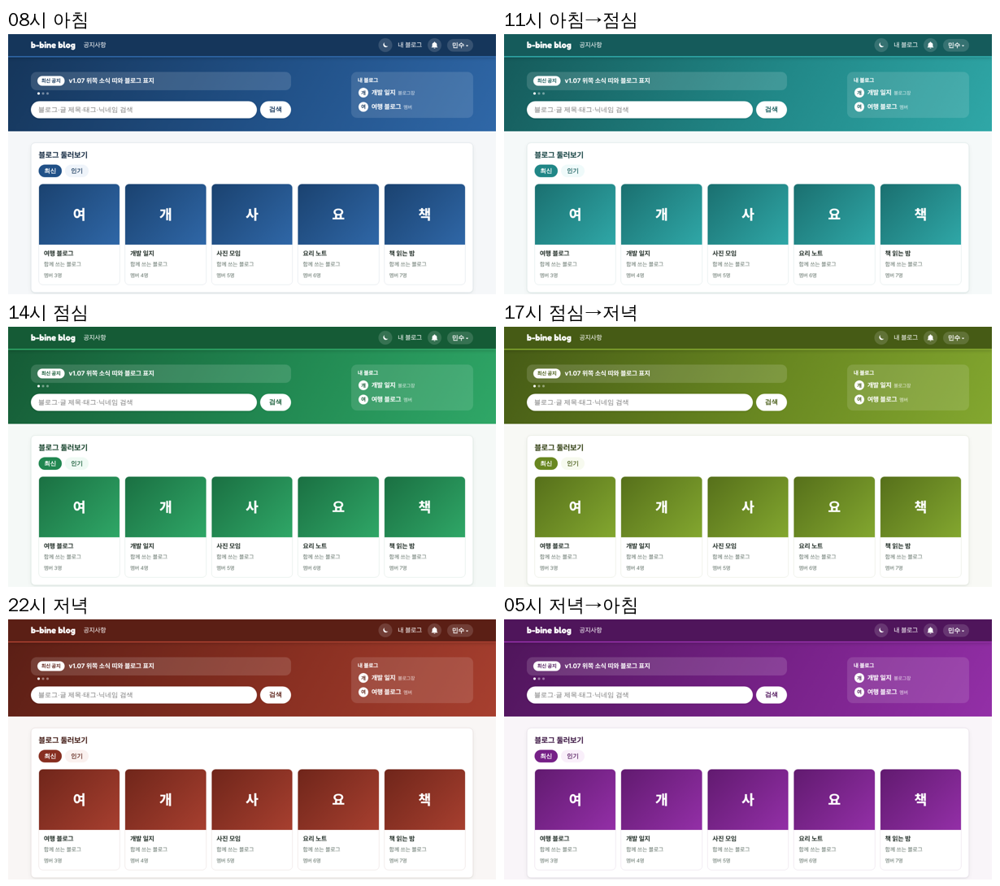
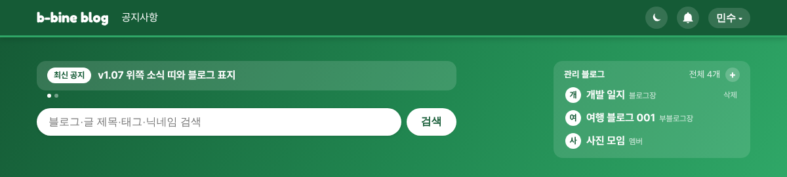

# v1.08 시간 따라 바뀌는 사이트 색

## 사이트 색이 시간에 따라 바뀌어요
아침(5~11시)에는 파랑, 점심(11~17시)에는 초록, 저녁(17~5시)에는 빨강으로 사이트 전체 색이 바뀝니다. 하루 내내 조금씩 넘어가서 바뀌는 순간이 눈에 띄지 않아요. 시간은 보고 계신 기기의 시각을 따르고, 다크 모드에서도 같은 색으로 어둡게 바뀝니다.

## 위쪽 띠가 깔끔해지고 내 블로그가 보여요
메인 위쪽 띠의 제목과 안내 문구를 빼고 소식 띠를 맨 위로 올렸습니다. 로그인하면 오른쪽 "관리 블로그"에 내 블로그가 최대 3개 보이고, 블로그가 없으면 비어 있어요. + 버튼으로 블로그를 만들고, 내가 블로그장인 블로그는 "삭제"로 폐쇄 화면에 갈 수 있어요. (넓은 화면에서만 보여요.)

## 내 블로그는 내 정보에서
위쪽 메뉴의 "내 블로그"를 빼고, 운영·참여하는 블로그 목록과 "블로그 만들기"를 내 정보 화면 아래로 옮겼습니다. 목록은 블로그를 만든 순서로 보여 줍니다.
