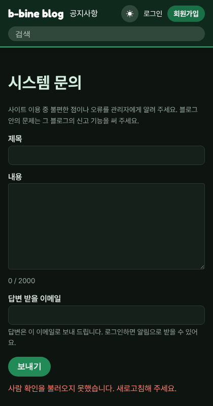
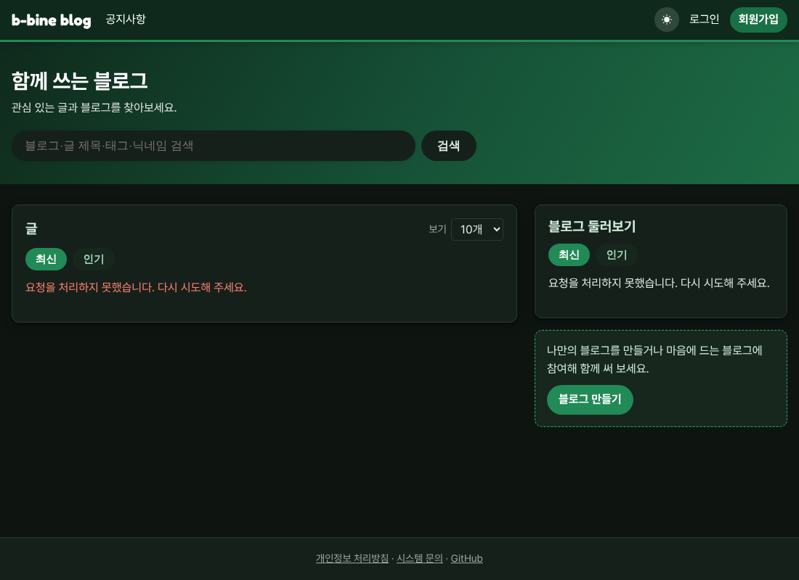

# v1.04 시스템 문의, 다크 모드

화면 맨 아래 "개인정보 처리방침" 옆에 "시스템 문의"가 생겼습니다. 사이트를 쓰다 불편한 점이나 오류를 관리자에게 바로 알릴 수 있어요.

- 회원은 로그인한 채로 보내면 되고, 답변이 달리면 알림으로 알려 드립니다. 닉네임 메뉴의 "내 문의"에서 답변을 다시 볼 수 있어요.
- 로그인하지 않아도 답변 받을 이메일을 적고 사람 확인을 하면 보낼 수 있습니다. 답변은 그 이메일로 보내 드려요.

어두운 화면(다크 모드)도 쓸 수 있습니다. 화면 위 메뉴 오른쪽의 달 모양 버튼을 누르면 바뀌고, 해 모양 버튼을 누르면 다시 밝아집니다. 고른 화면은 이 브라우저에 기억되고, 고른 적이 없으면 기기 설정을 따릅니다.

