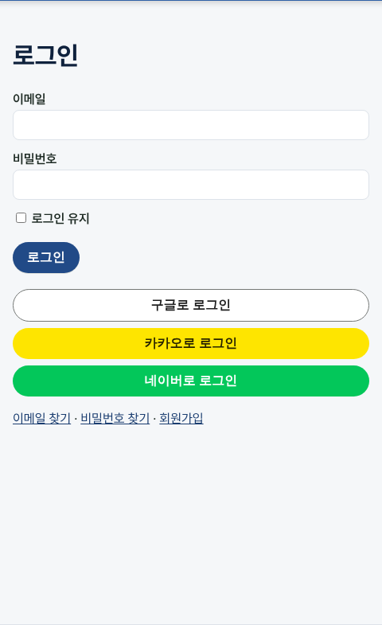
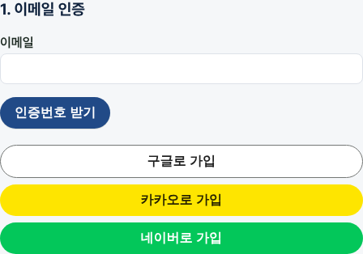
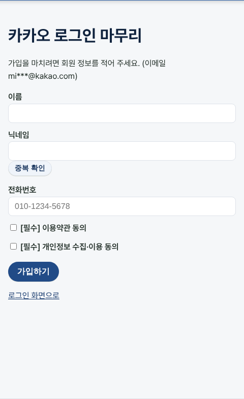
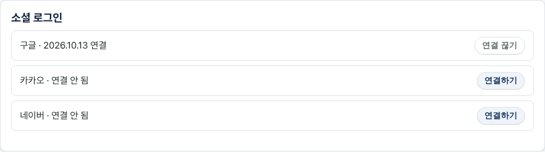

# v1.11 구글·카카오·네이버로 로그인

## 구글·카카오·네이버 계정으로 가입하고 로그인할 수 있어요
로그인 화면과 회원가입 화면에 "구글로 로그인", "카카오로 로그인", "네이버로 로그인" 버튼이 생겼어요. 처음 누르면 이름·닉네임·전화번호만 적고 동의하면 가입이 끝나요. 비밀번호는 만들지 않아도 되고, 다음부터는 버튼 한 번으로 로그인돼요.

왜 바꿨나요: 사용자 가입 편의성을 위해서요.

## 이미 가입한 이메일이면 비밀번호를 한 번 확인해요
소셜 계정의 이메일로 이미 가입한 회원이 있으면, 그 계정의 비밀번호를 한 번 확인한 뒤 연결하고 로그인해요. 소셜 계정이 이메일을 주지 않으면(카카오 등) 처음 가입할 때만 이메일을 적고 인증번호로 확인해요.

왜 바꿨나요: 사용자 가입 편의성을 위해서요.

## 내 정보에서 소셜 계정을 연결하거나 끊을 수 있어요
내 정보 화면에 "소셜 로그인" 칸이 생겼어요. 지금 계정에 구글·카카오·네이버를 연결하거나 끊을 수 있어요. 마지막 로그인 방법은 끊을 수 없어요. 소셜로만 가입했다면 "비밀번호 만들기"로 비밀번호를 만든 뒤 이메일로도 로그인할 수 있어요.

왜 바꿨나요: 사용자 가입 편의성을 위해서요.

