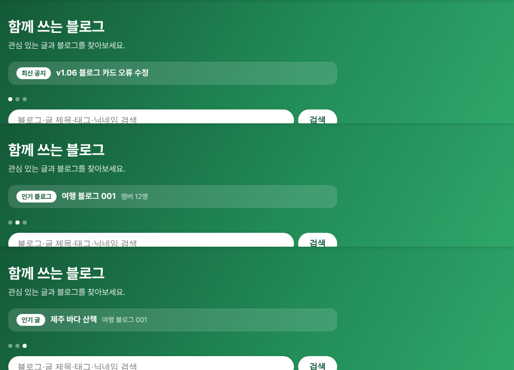
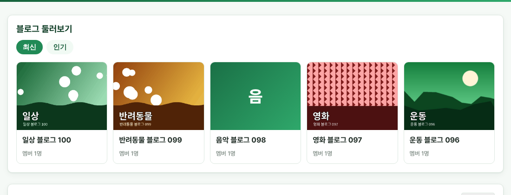

# v1.07 위쪽 소식 띠와 블로그 표지

메인 화면 위쪽 띠와 블로그 카드가 조금 더 풍성해졌습니다.

## 위쪽 띠에 소식이 번갈아 나와요
메인 화면 맨 위 띠에 최신 공지, 인기 블로그, 인기 글이 5초마다 번갈아 나옵니다. 아래 점을 누르면 원하는 소식으로 바로 넘어가고, 마우스를 올려 두면 잠시 멈춥니다.

## 블로그 카드에 표지가 보여요
블로그 카드에 대표 이미지(움직이는 이미지 포함)가 보입니다. 표지 파일을 찾지 못하는 블로그는 깨진 그림 대신 블로그 이름의 첫 글자를 보여 줍니다.

