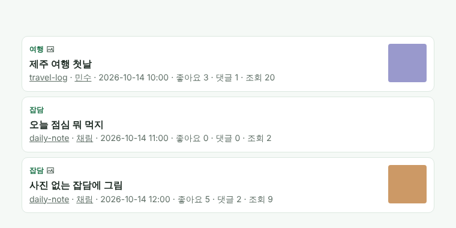

# v1.16 글 목록에 카테고리가 보여요

## 글 제목 위에 카테고리가 보여요
글 목록에서 제목 바로 위에 그 글의 카테고리 이름이 작게 표시돼요. 글에 그림이 들어 있으면 카테고리 옆에 그림 표시가 함께 나와요.

왜 바꿨나요: 글이 어디서 어떻게 쓰였는지 들어가지 않아도 목록에서 쉽게 알 수 있게 하고 싶었어요.

## "미분류"가 "잡담"으로 바뀌었어요
카테고리를 고르지 않은 글은 이제 "잡담"으로 보여요. 글쓰기 화면의 카테고리 선택과 블로그 탭 이름도 같이 바뀌었어요.
