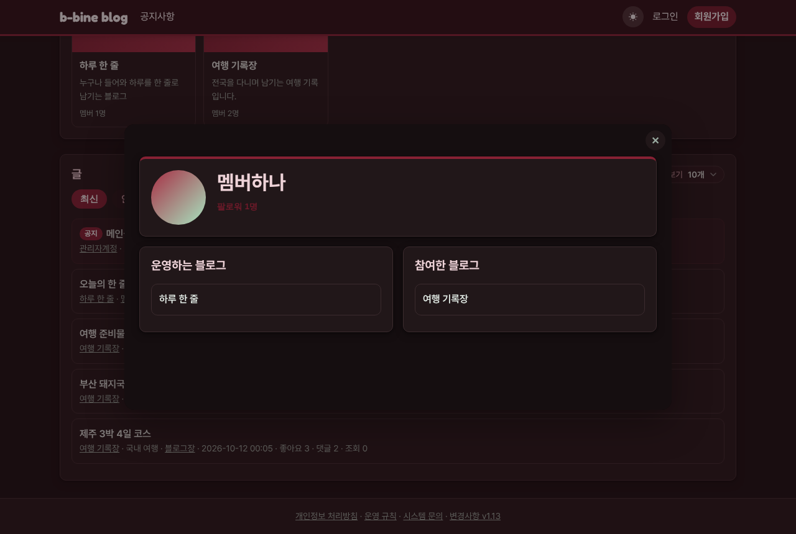

# v1.14 프로필을 창으로 띄워요

## 닉네임을 누르면 프로필이 창으로 떠요
글 목록, 글, 댓글, 팔로워 목록에서 닉네임을 누르면 보던 화면을 떠나지 않고 그 위에 프로필 창이 떠요. 창에서 팔로우·차단·신고를 하고, 블로그 이름을 누르면 그 블로그로 가요. 닫기(×), Esc, 창 바깥을 누르면 닫혀요.

왜 바꿨나요: 회원가입처럼 간단히 보는 화면은 창으로 통일해 나갈 예정이에요.

## 글 목록의 블로그 이름을 누르면 그 블로그로 가요
메인 글 목록에서 글 아래 줄의 블로그 이름을 누르면 바로 그 블로그로 이동해요.

왜 바꿨나요: 관심 있는 블로그에 들어가려면 글을 열거나 검색해야 하는 불편함이 있었어요.

## 댓글 칸이 본문과 같은 너비가 됐어요
글 화면의 댓글 칸이 본문 카드와 같은 너비로 넓어졌어요. 글 화면 디자인을 다듬은 거예요.
